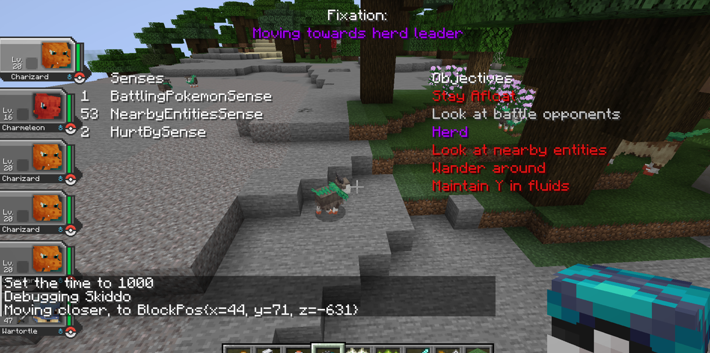

## Bigger Brains
The bigger brains system is Cobblemon's AI system, a conceptual mix of Minecraft's two AI systems, Goals and Brains.

Debugging is a first-class feature for Bigger Brains, with /debugcobblemonai added as a command to track the brain
state of the entity you're looking at.

Be mindful of performance. If something runs every tick, make sure it's efficient. Use tick cooldowns where you're doing
expensive operations and there's room to have it run with lower resolution. Noticing that a player is nearby, for
example, is not the most urgent thing in the world so can run every couple of seconds instead of every tick.

There are five main principles inside this system: *Memories*, *Senses*, *Objectives*, *Fixations*, and *Distractions*.

___

### [Memories](#memories)
Memories are directly taken from the Brain system in Minecraft. They are generic typed slots for specific pieces of
information. For example, a memory type can be created for the entity that is the leader of that entity's herd, and
the brain can store that entity in that memory slot.

Memories need to be registered against the entity's brain for the slot to be reserved. This is something that happens
at the behaviour configuration stage, using BehaviourConfigurationContext#addMemories. SenseConfig and ObjectiveConfig
instances are the ones typically responsible for this. If multiple configs register the same memory type, it is only
registered once.

Memories can be saved and loaded from NBT but aren't necessarily. It depends on how the memory type is declared. You
can't make a memory type transient for one entity and persistent for another. Herd leaders are either persistent for
all entities or persistent for none. The way you decide whether it's persistent or not is whether you supply a Codec
for that memory type when you register it. The Codec is used to serialize and deserialize the memory value to and
from NBT.

You should only make memories persistent if you need them to be. The more persistent memories there are, the
more bloat. It's not a huge deal though.

You should make changes to memories through the BiggerBrain instance rather than entity.brain. Technically both work,
mostly, but for subscribed memory handlers it needs to be through our brain.

New memory types can be registered in `CobblemonMemories`.

___

### [Senses](#senses)
Senses are a simple mechanism to have scheduled checks on the entity and its surroundings to update memories. These
could have been implemented as Objectives but the separation is for logical separation more than functional 
separation. Inside a Sense's `tick` function, you have to update the `ticksUntilNextExecution` yourself. This is to
allow for more flexible scheduling.

A sense is instantiated per entity, so if you have 10 Pokémon with the same behaviour configuration, there will be 10
instances of that sense. This is handy for making some senses parameterised in some way that's specific to the entity.

Senses are registered through SenseConfig instances in the behaviour configuration. Each SenseConfig is responsible
for instantiating the Sense for the entity and registering any memories it expects.

Senses are an analogue of SensorType from Brains.

___

### [Objectives](#objectives)

Objectives are also ticking objects that are instantiated per entity. They represent a goal for the entity and
run in a fixed order depending on the priority it was given in the configuration. `cobblemon:add_objectives`
configurations provide a map of priority to ObjectiveConfig instances. Each ObjectiveConfig is responsible for
instantiating the Objective for the entity and registering any memories it expects.

Objectives can do any logic they like. They do need to be conscious of any current [fixations](#fixations) on the brain

When an objective ticks, it has to return an `ObjectiveStatus` which is just used to communicate with debugging
players. The possible statuses are:

`FIXATED`: States that this objective owns the current fixation.

`ACTIVE`: States that the objective's logic is ongoing and not impeded.

`INACTIVE`: States that the objective is not performing any meaningful logic right now but isn't actively blocked.

`BLOCKED`: States that there are other objectives, fixations, etc. in play which prevents the objective from being
performed.

`INVALID`: States that the objective is not valid and shouldn't have been registered on the entity in the first place,
such as when placed on the wrong entity type.

___

### [Fixations](#fixations)

Fixations are a kind of task that can be set on the brain that represents a more total commitment to a certain task.
Only a single fixation can be active at a time. These can do anything, similar to an [objective](#objectives), and
they can be stopped either by deciding to stop on their own or by being affected by a [distraction](#distractions).

Fixations are set and distracted through the BiggerBrain instance. When a fixation is set, some objectives might
notice that the brain is currently fixated and decide to stop performing their logic until the fixation is cleared. 
Others might test to see if the current fixation is open to being distracted by a certain type of distraction, and 
if so interrupt the fixation to perform their logic.

For example, a fixation for wandering around might be interrupted by a distraction for being attacked, allowing the
entity to respond to the attack before going back to idle behaviour. Fleeing from an attacker would be another
fixation, which may only be distracted by forceful distractions.

There is a function to override on fixations if there is any clean up required upon being distracted. For a movement
fixation, the current movement tracker should be told to stop so that the entity's navigator is freed up and the entity
immediately stops moving.

Fixations are usually created by an [objective](#objectives) but that isn't a requirement. Anything can make the entity
fixate.

The debug overlay will render an active fixation in the top center. The fixations are encouraged to provide a clear
description, which can include specific information about progress.

There are specific interfaces for fixations which are necessary for [objectives](#objectives) and the rest of the mod
to understand what's going on.

#### LockFixation
A fixation that prevents Pokémon from being interacted with. It prevents Poké Ball hits, battles,
damage, etc. There are no obligations for a fixation to implement this interface, it's just a marker.

#### MovementTrackerFixation
A fixation that may utilise a movement tracker. This indicates that the current fixation intends to control the 
entity's movement. You should only implement this if there are zero circumstances under which some other part of the 
mod should be able to move the entity while this fixation is active.

An [objective](#objectives) that's responsible for keeping the entity above water or maintaining a certain altitude 
while flying would check whether the current fixation is a `MovementTrackerFixation`. It would then consider itself
blocked if it is and said fixation has a non-null movement tracker. Otherwise, it will continue doing its job even if
the entity is otherwise busy.

#### LookingTrackerFixation
A fixation that may utilise a looking tracker. This indicates that the current fixation intends to control the
entity's look direction. This is similar to MovementTrackerFixation but for looking direction.

___

### [Distractions](#distractions)
Distractions are how the mod will attempt to break a [fixation](#fixations). Distractions can come from objectives,
senses, or anywhere else in the mod. A distraction has any number of types, represented by the DistractionType enum. 
The types are used by the [fixation](#fixations) to determine whether it's open to being distracted by it.

When a distraction is attempted, the BiggerBrain instance will check whether there is a current fixation. If there
is, it will check whether the fixation is open to being distracted by any of that distraction's types. The distraction
types and their meanings are as follows:

`FORCE`: A forceful distraction that is considered vital. Every fixation should be open to being distracted by this.

`IDLE_BOREDOM`: A distraction that represents the entity just wanting to do something for trivial reasons. Wandering is
the best example of this. Few fixations should be open to this type of distraction.

`COMFORT`: A distraction that represents the entity wanting to do something for its own comfort. Moving out of water
when they don't like being wet, moving closer to the player owner, returning to the herd leader, etc.

`DAMAGE`: A distraction that involves the entity having been hurt.

___

### Implementing Pokémon Objectives
To implement a new objective for a Pokémon, there are a few things you'll need to do.

1. Create an `Objective` implementation. Inside of it, you need a `Config` class that extends `ObjectiveConfig`. In
`ObjectiveConfig`, add your objective to the map. Implement your objective logic.
2. Decide which Pokémon will get this objective. You'll need this in a `Behaviour`, so a JSON under the
`/data/cobblemon/behaviours/` folder. Inside the `pokemon/auto` folder are the behaviours that will run on all Pokémon
when initialising for the first time. These strictly contain references to other `Behaviours` that should run depending
on conditions. You may want a new `Behaviour` that adds your objective, and then add that `Behaviour` to one of the auto
behaviours with some condition. The conditions usually check the properties inside `PokemonBehaviour`, so you may need
to add something to that. If it's a new field, make sure it's added to the struct functions.
3. Configure any species that should have that behaviour to have whatever species JSON settings are necessary inside
its `PokemonBehaviour` configuration for your objective to apply.

Example: If you wanted to add an objective that made all Flying-type Pokémon fly up to a certain altitude when idle,
specifically non-party Pokémon, you would:
1. Create a `FlyUpObjective` class that extends `Objective`, with a nested `Config` class that extends `ObjectiveConfig`.
Implement the logic to make the Pokémon fly up when idle. This would include a fixation that implements 
MovementTrackerFixation. It would probably be distracted by anything except the `IDLE_BOREDOM` distraction type.
2. Create a new `Behaviour` JSON file that adds the `FlyUpObjective` to the objectives list, such as `cobblemon:fly_up`.
3. Add entries to `en_us.json` for translating the name and description of your new `Behaviour`.
4. Modify the `pokemon/auto/pokemon_non_party.json` behaviour to apply `cobblemon:fly_up` when the Pokémon has the
Flying type and is not in a party.

___

### Debugging
To help with debugging Bigger Brains, a command has been added: `/debugcobblemonai`. This command toggles debugging
for the player executing the command. When looking at an entity with a Bigger Brain, an overlay will be rendered on the
screen with information about the brain's current state.

Inside objectives or senses, you can get the `BiggerBrain` instance and call `sendDebugMessage` which will send a simple
chat message to any players currently debugging that entity's brain. This is useful for tracking down issues.