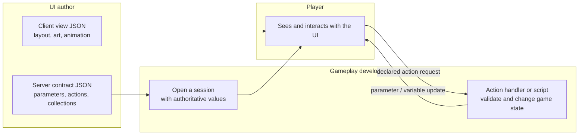
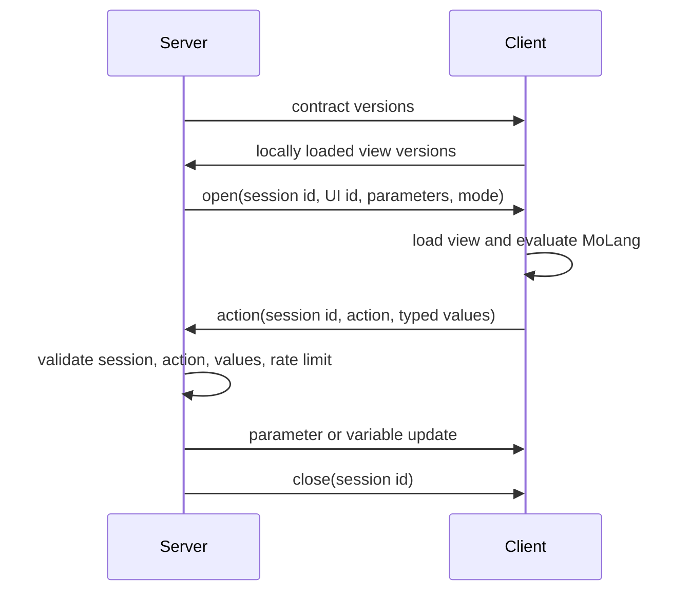

# MoLang UI

MoLang UI lets a server open a data-defined interface on a client. The interface is drawn from a client resource, while the server owns the session, its authoritative parameters, inventory collections, and every action that can change game state.

It is intended for interfaces such as a block menu, a short cinematic overlay, or a small interaction screen. It is not a way to execute arbitrary client input on the server.

## The two files

Every UI has one resource with the same id on each side:

| Side | Path | Responsibility |
| --- | --- | --- |
| Client resources | `assets/<namespace>/molang_ui/<path>.json` | Widget tree, layout, visuals, client-only variables, and event expressions. |
| Server data | `data/<namespace>/molang_ui/<path>.json` | Contract version, allowed parameters, server actions, screen/overlay mode, and optional inventory collections. |

For example, `example:confirmation` is made from:

```text
assets/example/molang_ui/confirmation.json
data/example/molang_ui/confirmation.json
```

The ids, `format_version`, `contract_version`, mode, parameters, and actions must agree. The server sends its known contract versions when a player connects; the client responds with the versions of its loaded views. A missing or different version disables that UI for the player and closes an existing session for it.

This means a server data pack alone is not enough for a graphical UI. Clients must also load the matching view through the mod or a resource pack.

## What each person works on



The UI author controls presentation. The gameplay developer controls what can open, which actions are accepted, and their result. Players can request an action, but cannot directly choose its server-side outcome.

## How a session works



The server creates each session with `MolangUiService.open`. It assigns the session id and sends the initial parameters. The client resolves the matching view and shows either an overlay or a screen.

When a widget event includes `on_click`, `on_change`, or another server event, the client evaluates the declared event parameters and sends the session id, action key, and values. The server accepts it only when all of the following are true:

- the session belongs to that player and is active;
- the action is declared by that UI's server contract;
- the supplied keys and types exactly match the action declaration;
- the action is within the rate limit.

An action handler must still validate game rules: permissions, distance, ownership, inventory contents, cooldowns, and any other condition that matters. Treat every client event value as a request, never as proof.

The server may update declared parameters or numeric client variables through the returned `MolangUiSessionHandle`. A session closes when the server closes its handle, the player closes its screen, a replacement screen opens, or compatibility is lost.

## Create a small confirmation UI

This example opens an overlay with a button. Pressing the button calls the server action `confirm`.

### 1. Add the client view

Create `assets/example/molang_ui/confirmation.json`:

```json
{
  "format_version": 1,
  "contract_version": "1.0.0",
  "mode": "overlay",
  "parameters": {
    "message": "string"
  },
  "actions": ["confirm"],
  "variables": { "v.pressed": 0 },
  "root": {
    "type": "panel",
    "anchor": "center",
    "size": [180, 72],
    "color": "0xEE202020",
    "controls": [
      {
        "message": {
          "type": "label",
          "anchor": "top_center",
          "offset": [0, 14],
          "size": [160, 12],
          "alignment": "center",
          "text": { "molang": "q.message" },
          "shadow": true
        }
      },
      {
        "confirm": {
          "type": "button",
          "anchor": "bottom_center",
          "offset": [0, -12],
          "size": [80, 18],
          "text": "Confirm",
          "color": "0xFF386641",
          "hover": { "color": "0xFF6A994E" },
          "on_click_client": { "molang": "v.pressed = 1" },
          "on_click": { "action": "confirm", "parameters": {} }
        }
      }
    ]
  }
}
```

Widget children use `controls`. Each entry has one name, such as `"confirm"`, and its widget definition. Use `anchor`, `offset`, and `size` to position it. A size component can be a number of GUI pixels or a percentage such as `"50%"`.

Plain values are literals. Wrap a value in `{ "molang": "..." }` when it must be evaluated every frame. Colors use `0xAARRGGBB`.

### 2. Add the server contract

Create `data/example/molang_ui/confirmation.json`:

```json
{
  "format_version": 1,
  "contract_version": "1.0.0",
  "mode": "overlay",
  "parameters": {
    "message": { "type": "string" }
  },
  "actions": {
    "confirm": { "parameters": {} }
  }
}
```

The client file describes what can be rendered. The server contract describes what is allowed. Keep the client action list and server action map in sync. The contract may make a parameter optional with `"required": false` and provide a `"default"`; it can also specify a MoLang default with `{ "molang": "..." }`.

Supported parameter types are `string`, `number`, `boolean`, and `vec3`. Parameter names use lower-case letters, digits, and underscores, begin with a letter or underscore, and cannot use a reserved UI query name.

### 3. Register the server behavior

Register an action handler during common initialization:

```kotlin
import com.cobblemon.mod.common.api.molangui.ActionKey
import com.cobblemon.mod.common.api.molangui.MolangUiActionRegistry
import com.cobblemon.mod.common.api.molangui.MolangUiActionHandler

MolangUiActionRegistry.register(ActionKey("confirm"), MolangUiActionHandler { context ->
    val player = context.player
    if (!player.hasPermissions(2)) return@MolangUiActionHandler

    // Perform the authoritative server-side result here.
    context.session.close()
})
```

An action can instead name a loaded Cobblemon script with `"handler": "example:my_action"`. The script receives the action arguments as variables. Server UI scripts expose only UI-scoped operations: `q.parameter`, `q.update_parameter`, `q.update_variable`, `q.close_ui`, inventory helpers, and the general formatting/conversion functions. They do not expose `q.player`.

### 4. Open it from server code

```kotlin
import com.cobblemon.mod.common.api.molangui.MolangUiOpenRequest
import com.cobblemon.mod.common.api.molangui.MolangUiService
import com.cobblemon.mod.common.api.molangui.ParameterValue
import net.minecraft.resources.ResourceLocation
import net.minecraft.server.level.ServerPlayer

fun openConfirmation(player: ServerPlayer) {
    val result = MolangUiService.open(
        player,
        MolangUiOpenRequest(
            ResourceLocation.fromNamespaceAndPath("example", "confirmation"),
            mapOf("message" to ParameterValue.StringValue("Ready to continue?"))
        )
    )

    // Inspect Opened or Rejected if the caller needs to report a failure.
}
```

`open` must run on the server thread. The returned `Opened` result includes a handle that can update the UI later:

```kotlin
session.updateParameters(mapOf("message" to ParameterValue.StringValue("Saved")))
session.updateVariables(mapOf("v.flash" to 1.0))
```

Parameters are part of the server contract and appear to the client as `q.message`. Variables are client presentation state and appear as `v.flash`. Variable updates must be finite numbers. Client-side event code can also change variables immediately; use that for visual feedback, then wait for a server update for authoritative results.

## MoLang values available in a view

Declared parameters become `q.<name>`. A view also has these client queries:

| Query | Meaning |
| --- | --- |
| `q.gui_id` | Full UI id, for example `example:confirmation`. |
| `q.gui_time` | Seconds since the UI opened. |
| `q.delta` | Frame delta in seconds. |
| `q.screen_width`, `q.screen_height` | GUI dimensions in pixels. |
| `q.mouse_x`, `q.mouse_y` | Mouse position in GUI pixels. |
| `q.translate(key)` | A translated component rendered as text. |
| `q.item_name(item_id)` | Localized item name. |
| `q.item.index` | Index inside a `list` item template. |
| `q.event.type`, `q.event.widget_id` | Available while a widget event runs. |

Use `v.<name>` for local numeric state. The view's `variables` object supplies initial values. `list` item templates also receive `q.item.index`.

## Widget reference

All widgets support `anchor`, `offset`, `size`, `visible`, `enabled`, `opacity`, and child `controls` where meaningful. `visible`, `enabled`, and numeric layout values may be literals or MoLang expressions.

| Widget | Main properties |
| --- | --- |
| `panel` | `color`, `texture`, `uv`, `texture_size`; groups child controls. |
| `fill` | `color`; draws a solid rectangle. |
| `label` | `text`, `color`, `alignment`, `shadow`, `scale`. |
| `image` | `texture`, `uv`, `texture_size`. |
| `button` | `text`, `color`, `hover`, plus event properties. |
| `progress_bar` | `value`, `max`, `color`, `background_color`, `direction`. |
| `list` | `source`, `source_type`, `layout`, `spacing`, `item_template`. |
| `scroll_panel` | A clipped, scrollable panel. |
| `number_input` | `variable`, `min`, `max`, `step`, `value`, `color`, `button_color`. |
| `item_slot` | `item`; renders an item without a server inventory slot. |
| `pokemon_render` | Renders a Pokémon preview. |
| `slot_grid` | `collection_name`, `grid_dimensions`; only for a `screen` contract with a matching server collection. |

Use `hover` to override visual properties while a widget is hovered, for example `"hover": { "color": "0xFF777777" }`. The included `vending_machine.json` is the full example for `slot_grid`, collection rules, pagination, and server parameter updates. `battle_intro.json` shows a lightweight animated overlay.

The template library at `assets/<namespace>/molang_ui/templates/<name>.json` can hold reusable widget shapes. The bundled `common.json` includes `panel`, `label`, `button`, and `progress_bar` templates.

## Screen mode and inventory collections

Use `"mode": "overlay"` for a non-container overlay. A player can have up to eight active overlays. Set `"exclusive": true` when the overlay should block the normal HUD while active.

Use `"mode": "screen"` for a regular screen. Opening it replaces the player's previous MoLang screen. A screen can declare `collections` in its server contract and render them with `slot_grid` in its view. The server owns collections, slot validity, shift-click routing, and item return policy; the client only draws their declared layout.

For a block entity collection, pass its position through `MolangUiOpenRequest(..., blockPos = pos)`. The server checks that the player is nearby, the chunk is loaded, and the block entity is a valid container before opening it.
